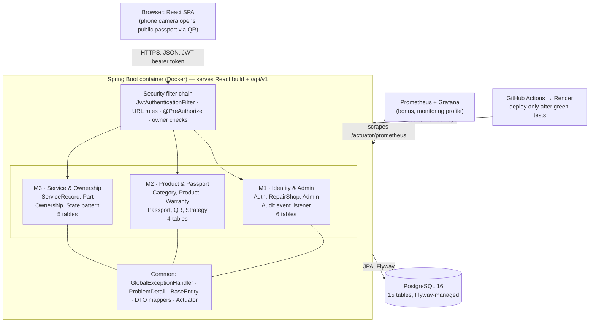
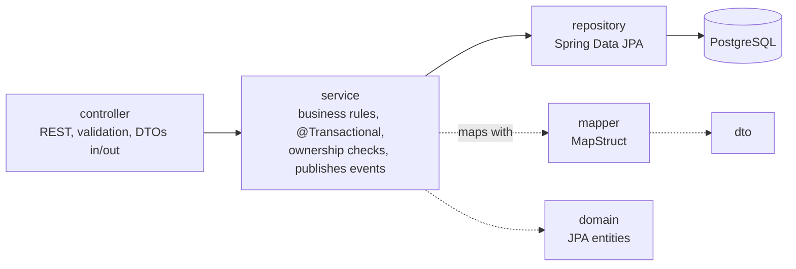
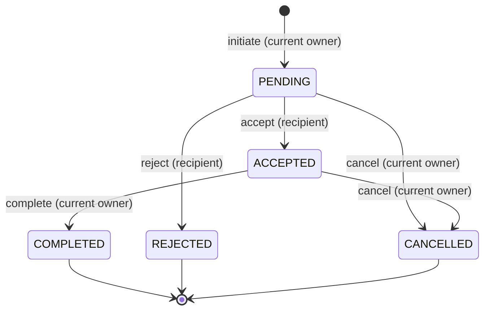

# LifeLedger — Architecture

LifeLedger is a **layered monolith, packaged by feature**. One Spring Boot container serves the React build and the REST API (`/api/v1`), backed by PostgreSQL. Spring Security guards every request, the service layer enforces ownership and business rules, and repositories are the only code that touches the database.

## Deployment view



## Layers inside each feature package



Entities never leave the service layer; controllers only see DTOs.

## Package structure

```
com.lifeledger
├── common         exception handler, ProblemDetail, BaseEntity, config    (M1)
├── auth           JWT, filters, login/logout                              (M1)
├── user           users, roles                                            (M1)
├── repairshop     applications, approval                                  (M1)
├── admin          admin endpoints                                         (M1)
├── audit          domain events, listener, audit log                      (M1)
├── product        products, categories, validation strategies             (M2)
├── warranty       warranties                                              (M2)
├── passport       QR, public and shared views, access grants              (M2)
├── servicerecord  service records, parts                                  (M3)
└── ownership      transfers (State pattern), ownership history, timeline  (M3)
```

## Cross-module contracts

| From → To | Contract | Agreed |
|---|---|---|
| M1 → M3 | `RepairShopQueryService.isApproved(shopId)` | Day 2 |
| M1 → M2, M3 | `CurrentUserProvider`, `AuditableEvent` (M2/M3 publish, M1's `AuditEventListener` stores) | Day 2 |
| M2 → M3 | `ProductAccessService.canViewHistory(productId, user)` | Day 4 |
| M3 → M2 | Completing a transfer calls `ProductService.changeOwner(...)` and `AccessGrantService.revokeAll(productId)` in one transaction | Day 6 |

## Design patterns

| Pattern | Where | Owner |
|---|---|---|
| Strategy | `ProductValidationStrategy` → `LaptopValidationStrategy`, `DesktopValidationStrategy` | M2 |
| Factory / Registry | `ValidationStrategyRegistry` picks a strategy from an injected `Map<String, ProductValidationStrategy>` | M2 |
| State | `TransferState` → `PendingState`, `AcceptedState`, `CompletedState`, `RejectedState`, `CancelledState` | M3 |
| Observer | `ApplicationEventPublisher` + `AuditEventListener` | M1 (listener), M2 + M3 (publishers) |
| Chain of Responsibility | `JwtAuthenticationFilter` in the Spring Security filter chain | M1 |
| Builder | `PassportView` and response DTOs with `@Builder` | M2 |
| Repository | Spring Data JPA repositories per aggregate | All |
| DTO + Mapper | MapStruct mappers; entities never leave the service layer | All |

## Ownership transfer state machine (M3)



Any other transition throws `InvalidStateTransitionException` → **409 Conflict**. Completing a transfer changes the owner, closes the old `ownership_history` row and opens a new one, revokes all access grants, and gives the recipient the SELLER role, all in one transaction.
