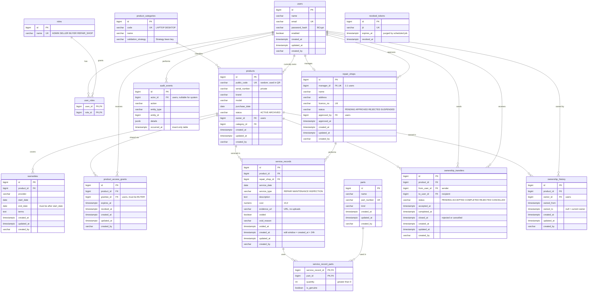

# LifeLedger — Entity Relationship Diagram

Status: **draft for team sign-off** (freeze by end of Day 2). After the freeze, any change needs a new Flyway migration and a reviewed PR.

15 tables. Owners: **M1** Shahriar (identity), **M2** Ariful (product), **M3** Majharul (service & ownership).

## Relationship coverage (rubric: entity relationships, 10 marks)

| Type | Example |
|---|---|
| 1:M | `product_categories` → `products`, `products` → `warranties`, `repair_shops` → `service_records` |
| M:1 | `products` → `users` (owner), `service_records` → `products` |
| 1:1 | `users` ↔ `repair_shops` (shop manager, unique `manager_id`) |
| M:M | `users` ↔ `roles` via `user_roles`; `service_records` ↔ `parts` via `service_record_parts` (with `quantity`, `is_genuine`); `products` ↔ `users` via `product_access_grants` |

## Constraints and indexes

- Unique: `users.email`, `roles.name`, `products.public_code`, `product_categories.code`, `repair_shops.manager_id`, `repair_shops.licence_no`, `parts.part_number`, `revoked_tokens.jti`.
- Index every foreign key column.
- Partial unique index, so a product has at most one open transfer:
  `CREATE UNIQUE INDEX ux_open_transfer ON ownership_transfers(product_id) WHERE status IN ('PENDING','ACCEPTED');`
- Partial unique index, so a product has exactly one current owner row:
  `CREATE UNIQUE INDEX ux_current_owner ON ownership_history(product_id) WHERE owned_to IS NULL;`
- Checks: `service_record_parts.quantity > 0`, `warranties.end_date > start_date`, `ownership_transfers.from_user_id <> to_user_id`, `voided = false OR void_reason IS NOT NULL`.

## Rules

- **Naming:** snake_case, plural table names, `id BIGINT GENERATED ALWAYS AS IDENTITY`, FKs named `<entity>_id` (role-named FKs such as `from_user_id`, `approved_by` where one table references `users` twice).
- **Auditing columns:** `created_at`, `updated_at`, `created_by` via the shared `BaseEntity` and JPA auditing, on every table except the reference tables (`roles`, `product_categories`), the join tables (`user_roles`, `service_record_parts`) and the log tables (`revoked_tokens`, `audit_events`). The schema itself is `src/main/resources/db/migration/V1__init_schema.sql`.
- **History is never overwritten:** service records are voided, not deleted; ownership history rows are closed with `owned_to`; audit events are insert-only.
- **Privacy:** `serial_number` and the owner never appear in the public passport DTO.
