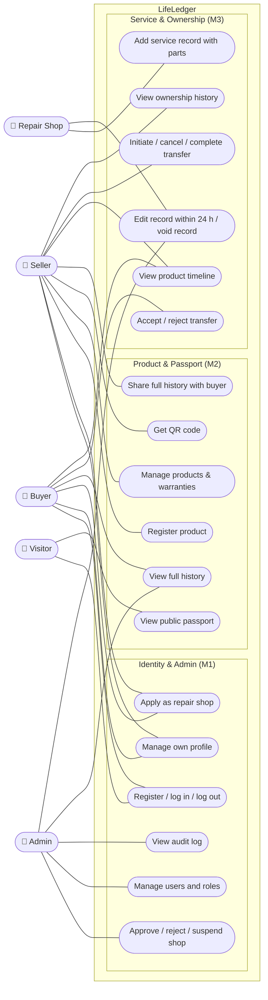

# LifeLedger — Use-Case Diagram

Actors: **Visitor** (not logged in), **Buyer**, **Seller** (product owner), **Repair Shop** (approved shop), **Admin**. Buyer, Seller and Repair Shop are all registered users; product ownership is checked per record, not by role.

## Use-case notes

| Use case | Actor | Rule |
|---|---|---|
| Register | Visitor | Chooses SELLER or BUYER. ADMIN is seeded; REPAIR_SHOP is granted on approval. |
| Apply as repair shop | Seller, Buyer | Creates a PENDING shop; Admin approval grants REPAIR_SHOP. |
| Add service record | Repair Shop | Only APPROVED shops; otherwise 403. |
| Edit / void record | Repair Shop (creator), Admin | Edit only within 24 h; deletion voids with a reason, never hard-deletes. |
| View public passport | Anyone | Model, category, record count and dates, verification labels; no serial number, no owner. |
| View full history / timeline | Owner, Buyer with active grant, Admin | Service, ownership and warranty events merged by date. |
| Initiate transfer | Seller (current owner) | Recipient by email; cannot transfer to self; one open transfer per product. |
| Accept / reject transfer | Recipient | Only from PENDING. |
| Complete transfer | Seller (sender) | Only from ACCEPTED; owner changes, shares revoked, recipient gains SELLER. |
